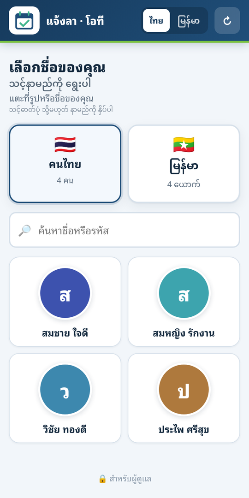
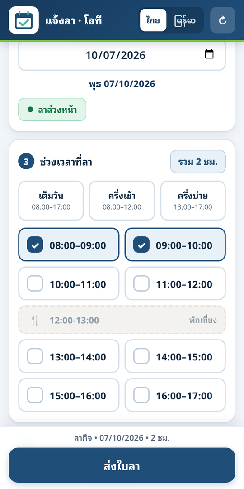
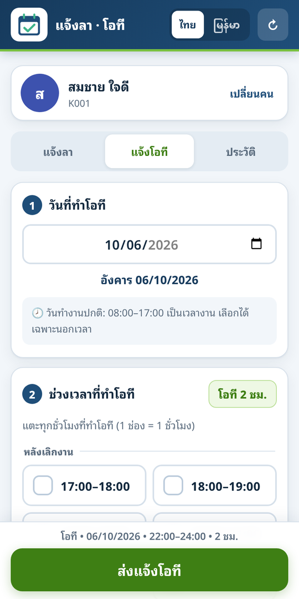

# ระบบแจ้งลา + โอที พนักงาน (แม่แบบ)

ระบบแจ้งลาและแจ้งโอทีสำหรับโรงงาน/บริษัทขนาดเล็ก–กลาง ใช้ฟรีทั้งหมดบนบัญชีของคุณเอง

- **หน้าเว็บ** (มือถือเป็นหลัก ไทย + พม่า) — พนักงานเลือกชื่อ แจ้งลา แจ้งโอที ได้สลิปพร้อม QR
- **Google Sheet** ของคุณ — เก็บข้อมูลทั้งหมด และสรุปยอดตามรอบเงินเดือนให้อัตโนมัติ
- **Telegram** (ไม่บังคับ) — แจ้งเตือนเข้ากลุ่มหัวหน้า กดอนุมัติ/ยืนยันในแชตได้

> repo นี้เป็น **แม่แบบเปล่า** ไม่มีข้อมูลพนักงานหรือการตั้งค่าของใครติดมา ทุกอย่างสร้างใหม่ในบัญชี Google ของคุณตอนติดตั้ง

| เลือกชื่อ | แจ้งลา | สลิป (มี QR) | แจ้งโอที |
|---|---|---|---|
|  |  |  |  |

*(ชื่อในภาพเป็นข้อมูลสมมติ)*

## ทำอะไรได้

**พนักงาน**
- แจ้งลา: ลาป่วย / ลากิจ / ลาพักร้อน เลือกวันเดียวหรือหลายวัน เลือกช่วงเวลารายชั่วโมง ระบบบอกเองว่าเป็นลาล่วงหน้า / กระทันหัน / ย้อนหลัง
- แจ้งโอที: เลือกวัน + ช่วงเวลา (05:00–24:00) วันทำงานเลือกได้เฉพาะนอกเวลางาน วันหยุดเลือกได้ทุกช่วง
- ได้สลิปเป็นรูป มี QR ให้หัวหน้าสแกนตรวจว่าเป็นของจริง
- ดูประวัติลา/โอทีของตัวเอง และยกเลิกรายการที่แจ้งผิดได้

**ผู้ดูแล (ใส่ PIN)**
- เพิ่ม/แก้ไข/ลบพนักงาน นำเข้ารายชื่อจาก Excel อัปโหลดรูป แก้รหัสพนักงานได้ (ระบบตามแก้ประวัติเก่าให้)
- ลงโอทีให้หลายคนพร้อมกัน ("เลือกทุกคน" แล้วติ๊กออก) ยืนยัน/ไม่ยืนยันโอทีที่พนักงานแจ้งเอง
- วันหยุดบริษัท วันทำงานพิเศษ และ **สลับวันหยุด** (เช่น ทำงานวันอาทิตย์นี้ หยุดวันอังคารแทน)
- สรุปการลารายเดือน/รายรอบ ส่งออก CSV

**Google Sheet**
- ชีต **สรุป**: ทุกคนในหน้าเดียว — ชั่วโมงลา วันลา ยอดหักเงิน โอทีวันทำงาน/วันหยุด ตามรอบเงินเดือนที่เลือก
- ชีต **รายวัน**: ดูทีละคน กรอกค่าแรง โควต้าลา ติ๊กว่าวันไหนหักเงิน
- ชีต **อ่านก่อน**: คู่มือในตัว อธิบายทุกชีต

**Telegram**
- แจ้งเตือนทุกครั้งที่มีคนลา/แจ้งโอที สรุป "พรุ่งนี้ใครลา" ตอนเย็น และ "วันนี้ใครลา" ตอนเช้า
- ปุ่มค้างล่างจอ: วันนี้ / พรุ่งนี้ / 7 วัน / รออนุมัติ / โอที / เพิ่มเติม
- กดอนุมัติลาพักร้อน ยืนยันโอที สลับวันหยุด และดูข้อมูลรายคน ได้ในแชต

## ต้องมีอะไรก่อน

1. บัญชี Google 1 บัญชี (ใช้ Google Sheets + Apps Script — ฟรี)
2. ที่วางหน้าเว็บ — แนะนำ **Cloudflare Pages** (ฟรี และใช้ไฟล์ `functions/tg.js` สำหรับ Telegram ได้เลย) จะใช้ GitHub Pages / Netlify ก็ได้
3. (ถ้าจะใช้แจ้งเตือน) บัญชี Telegram + กลุ่มสำหรับหัวหน้า

## ติดตั้ง

> อยากให้ AI ช่วย: เปิด repo นี้ให้ AI ของคุณ (Claude, ChatGPT ฯลฯ) แล้วบอกว่า **"อ่านไฟล์ AGENTS.md แล้วพาฉันติดตั้งระบบนี้ทีละขั้น"** — ในไฟล์นั้นบอกไว้ว่าขั้นไหน AI ทำแทนได้ ขั้นไหนคุณต้องกดเอง

### ขั้นที่ 1 — ก๊อบปี้ repo นี้เป็นของคุณ
กดปุ่ม **Use this template** (มุมขวาบน) → Create a new repository → ตั้งเป็น Private ได้

### ขั้นที่ 2 — สร้างหลังบ้าน (Google Sheet + Apps Script)
1. สร้าง Google Sheet เปล่า ตั้งชื่อตามใจ (เช่น "ระบบลา")
2. เมนู **ส่วนขยาย → Apps Script** ลบโค้ดที่มีอยู่ทิ้ง แล้ววางเนื้อหาไฟล์ [`backend/Code.gs`](backend/Code.gs) ทั้งหมด
3. แก้บล็อก **"⚙️ ตั้งค่าของบริษัท"** ด้านบนสุดของไฟล์ (ชื่อบริษัท ที่อยู่) → กดบันทึก
4. กดรูปเฟือง (การตั้งค่าโปรเจ็กต์) → เขตเวลา → เลือก **(GMT+07:00) Bangkok**
5. กลับมาหน้าโค้ด เลือกฟังก์ชัน **`setup`** → กด **เรียกใช้ (Run)** → อนุญาตสิทธิ์ตามที่ถาม (ครั้งแรกครั้งเดียว)
   ระบบจะสร้างชีตทั้งหมดให้เอง: อ่านก่อน, สรุป, Employees, Leaves, OT, Payroll, รายวัน, Holidays, WorkExtra, CancelLog, Settings
6. กด **ทำให้ใช้งานได้ (Deploy) → การทำให้ใช้งานได้รายการใหม่** → ประเภท **เว็บแอป**
   - เรียกใช้ในฐานะ: **ฉัน**
   - ผู้มีสิทธิ์เข้าถึง: **ทุกคน**
   → กด Deploy แล้ว **ก๊อบปี้ URL ที่ลงท้ายด้วย `/exec`**

### ขั้นที่ 3 — ตั้งค่าหน้าเว็บ
แก้ 2 ไฟล์ใน repo ของคุณ
1. [`config.js`](config.js)
   - `API_URL` = URL `/exec` จากขั้นที่ 2
   - `SITE_URL` = ที่อยู่เว็บของคุณ (เว้นว่างได้)
   - `COMPANY_NAMES` = ชื่อบริษัทที่จะขึ้นบนสลิป
2. [`functions/tg.js`](functions/tg.js) — `GAS_URL` = URL `/exec` เดียวกัน (ข้ามได้ถ้าไม่ใช้ Telegram)
3. เปลี่ยนไฟล์ `logo.png` เป็นโลโก้ของคุณ (รูปสี่เหลี่ยมจัตุรัส พื้นใส)

### ขั้นที่ 4 — เอาหน้าเว็บขึ้นโฮสต์ (Cloudflare Pages)
1. Cloudflare → Workers & Pages → Create → Pages → Connect to Git → เลือก repo ของคุณ
2. Framework preset: **None** · Build command: เว้นว่าง · Build output directory: `/`
3. Deploy → ได้ที่อยู่ `https://<ชื่อโปรเจกต์>.pages.dev` (ผูกโดเมนของตัวเองได้ที่ Custom domains)
4. เปิดชีต แท็บ **Settings** → แถว `site_url` → ใส่ที่อยู่เว็บนั้น (ใช้ทำลิงก์ตรวจสลิป)

### ขั้นที่ 5 — ใช้งานครั้งแรก
1. เปิดเว็บ → เลื่อนลงล่างสุด กด **🔒 สำหรับผู้ดูแล** → PIN เริ่มต้น **`1234`**
2. แท็บ **ตั้งค่า** → **เปลี่ยน PIN ทันที** และตั้งวันตัดรอบเงินเดือน
3. แท็บ **พนักงาน** → เพิ่มพนักงาน หรือกด "📋 นำเข้ารายชื่อ" (ก๊อบปี้จาก Excel มาวาง)
4. ลองแจ้งลา 1 ใบ แล้วดูว่าขึ้นในชีต Leaves

### ขั้นที่ 6 — Telegram (ไม่บังคับ)
1. คุยกับ **@BotFather** → `/newbot` → ได้ **token**
2. @BotFather → `/setprivacy` → เลือกบอท → **Disable** (ไม่งั้นปุ่มล่างจอในกลุ่มจะกดแล้วเงียบ)
3. สร้างกลุ่ม Telegram → เพิ่มบอทเข้ากลุ่ม → พิมพ์ `/start@ชื่อบอท` ในกลุ่ม 1 ครั้ง
4. เปิดเว็บ → ผู้ดูแล → ตั้งค่า → Telegram → วาง token → บันทึก
5. เปิดชีต แท็บ **Settings** → แถว `tg_webhook_url` → ใส่ `https://<เว็บของคุณ>/tg`
6. Apps Script → เลือกฟังก์ชัน **`connectTelegramNow`** → Run → ดูผลใน "บันทึกการดำเนินการ"
   (ระบบหาเลขกลุ่มเอง ผูก webhook เปิดสรุปรายวัน และส่งปุ่มเมนูเข้ากลุ่ม)

## ปรับแต่ง

| อยากเปลี่ยน | แก้ที่ไหน |
|---|---|
| ชื่อบริษัท / ที่อยู่ | ชีต Settings (`company_name`, `company_address`) และ `config.js` (`COMPANY_NAMES`) |
| PIN ผู้ดูแล, วันตัดรอบ, โอทีแจ้งย้อนหลังได้กี่วัน | หน้าผู้ดูแล → ตั้งค่า |
| โลโก้ | ไฟล์ `logo.png` |
| สีของเว็บ | `styles.css` บรรทัด `:root{ --brand: ... }` |
| สีของชีต | `backend/Code.gs` ตัวแปร `UI_C` |
| เวลาทำงาน (ค่าเริ่มต้น 08:00–17:00 พัก 12:00–13:00 = 8 ชม./วัน) | ฝังอยู่หลายจุดทั้งหลังบ้านและหน้าเว็บ (เริ่มที่ `TIME_SLOTS` / `DAY_BLOCKS`) — ให้ AI ไล่แก้ทั้งระบบ ดูหัวข้อ "ถ้าจะเปลี่ยนเวลาทำงานหรือวันหยุดประจำสัปดาห์" ใน `AGENTS.md` |
| วันหยุดประจำสัปดาห์ (ค่าเริ่มต้น = วันอาทิตย์) | ฝังอยู่หลายจุดเช่นกัน — ดู `AGENTS.md` หัวข้อเดียวกัน (ถ้าแค่บางสัปดาห์ ใช้ "สลับวันหยุด" ในระบบได้เลย ไม่ต้องแก้โค้ด) |
| คำแปลไทย/พม่า | `i18n.js` ตาราง `STR` |
| ให้พนักงานพม่าลาพักร้อนได้ (ค่าเริ่มต้นล็อกไว้) | `renderTypeChips` ใน `app.js` |
| เวลาส่งสรุปรายวันใน Telegram | ชีต Settings (`summary_eve_hour`, `summary_morning_hour` ฯลฯ) แล้วกดเมนู Telegram → เปิด/อัปเดตสรุปรายวัน |

## อัปเดตระบบภายหลัง

- **หลังบ้าน**: วาง `Code.gs` ใหม่ทับ → บันทึก → รัน `setup` (ถ้าโครงสร้างชีตเปลี่ยน — รันซ้ำได้ ข้อมูลเดิมไม่ถูกลบ) → **Deploy → จัดการการทำให้ใช้งานได้ → ✏️ → เวอร์ชันใหม่** (ต้องเลือก "เวอร์ชันใหม่" URL จึงจะเป็นตัวเดิม)
- **หน้าเว็บ**: แก้ไฟล์ → บวกเลข `?v=` ของไฟล์นั้นใน `index.html` (ให้มือถือโหลดของใหม่) → push

## ไฟล์ใน repo

```
backend/Code.gs     หลังบ้านทั้งหมด (วางใน Apps Script — ไม่ได้รันจาก repo)
index.html          โครงหน้าเว็บ
config.js           ⚙️ ตั้งค่า: URL หลังบ้าน ชื่อบริษัท โลโก้ เวลาทำงาน
app.js              ฝั่งพนักงาน: เลือกชื่อ แจ้งลา ประวัติ ตรวจสลิป
ot.js               แจ้งโอที (พนักงาน + ผู้ดูแล)
admin.js            หน้าผู้ดูแล
slip.js             วาดสลิป + QR
i18n.js             คำแปลไทย / พม่า
styles.css          หน้าตา
functions/tg.js     ตัวส่งต่อ Telegram (Cloudflare Pages Function) → https://<เว็บ>/tg
fonts/ vendor/      ฟอนต์ Noto Sans Thai Looped + Noto Sans Myanmar (OFL) · qrcode.js (MIT)
AGENTS.md           คู่มือสำหรับ AI ที่จะช่วยติดตั้ง/แก้ไขระบบนี้
```

## ปัญหาที่พบบ่อย

| อาการ | สาเหตุ / วิธีแก้ |
|---|---|
| หน้าเว็บขึ้น "ยังไม่ได้ตั้งค่าระบบ" | ยังไม่ได้ใส่ `API_URL` ใน `config.js` |
| หน้าเว็บขึ้น "โหลดข้อมูลไม่สำเร็จ" | Deploy เว็บแอปยังไม่ได้ตั้ง "ผู้มีสิทธิ์เข้าถึง: ทุกคน" หรือ URL ไม่ได้ลงท้าย `/exec` |
| แก้โค้ดหลังบ้านแล้วไม่เห็นผล | ลืมกด Deploy → จัดการ → ✏️ → **เวอร์ชันใหม่** |
| แก้หน้าเว็บแล้วมือถือยังเป็นของเก่า | ลืมบวกเลข `?v=` ใน `index.html` |
| Google ขึ้น "ไม่สามารถเปิดไฟล์ได้" ตอนเปิด Apps Script | ล็อกอิน Google หลายบัญชีพร้อมกัน — เปิดหน้าต่างไม่ระบุตัวตนแล้วล็อกอินบัญชีเดียว |
| ปุ่มล่างจอใน Telegram กดแล้วบอทเงียบ | ยังไม่ได้ปิด privacy (`/setprivacy` → Disable) — ปิดแล้วต้องเตะบอทออกจากกลุ่มและเชิญกลับ หรือให้บอทเป็นแอดมินกลุ่ม |
| บอท Telegram ตอบช้ามาก/ค้าง | ไม่ได้ตั้ง `tg_webhook_url` (Telegram ยิงเข้า Apps Script ตรง ๆ แล้วยิงซ้ำ) — ทำขั้นที่ 6 ข้อ 5–6 |
| `connectTelegramNow` บอก "ยังไม่เจอกลุ่ม" | พิมพ์ `/start@ชื่อบอท` ในกลุ่มก่อน แล้วรันใหม่ |
| วันที่ในชีตเพี้ยนไป 1 วัน | เขตเวลาของ Apps Script ไม่ใช่ Bangkok (ขั้นที่ 2 ข้อ 4) |

## ข้อควรรู้

- ข้อมูลทั้งหมดอยู่ใน Google Sheet ของคุณ — ใครมีสิทธิ์เปิดชีตก็เห็นข้อมูลพนักงานและ token ของบอท (แท็บ Settings) จึงควรแชร์ชีตเฉพาะคนที่จำเป็น
- รูปพนักงานเก็บในโฟลเดอร์ Google Drive ของคุณ และตั้งเป็น "ทุกคนที่มีลิงก์ดูได้" เพื่อให้หน้าเว็บแสดงรูปได้
- หน้าเว็บสำหรับพนักงานไม่มีการล็อกอิน (เลือกชื่อแล้วแจ้งได้เลย) เหมาะกับการใช้ภายในที่เน้นความง่าย — หน้าผู้ดูแลป้องกันด้วย PIN
- คำแปลภาษาพม่าควรให้เจ้าของภาษาอ่านทวนก่อนใช้จริง
- ห้ามเปลี่ยนชื่อชีต หรือแทรก/ลบ/สลับคอลัมน์ในชีต Employees, Leaves, OT, Settings

## สิทธิ์การใช้งาน

สัญญาอนุญาตแบบ MIT (ดูไฟล์ [`LICENSE`](LICENSE)) — นำไปใช้ แก้ไข และแจกต่อได้อย่างอิสระ ไม่มีการรับประกันใด ๆ ผู้ใช้รับผิดชอบการตรวจสอบความถูกต้องของยอดลา/โอที/เงินเดือนเอง
ฟอนต์ในโฟลเดอร์ `fonts/` ใช้สัญญาอนุญาต SIL OFL 1.1 และ `vendor/qrcode.js` ใช้ MIT ของผู้พัฒนาเดิม
